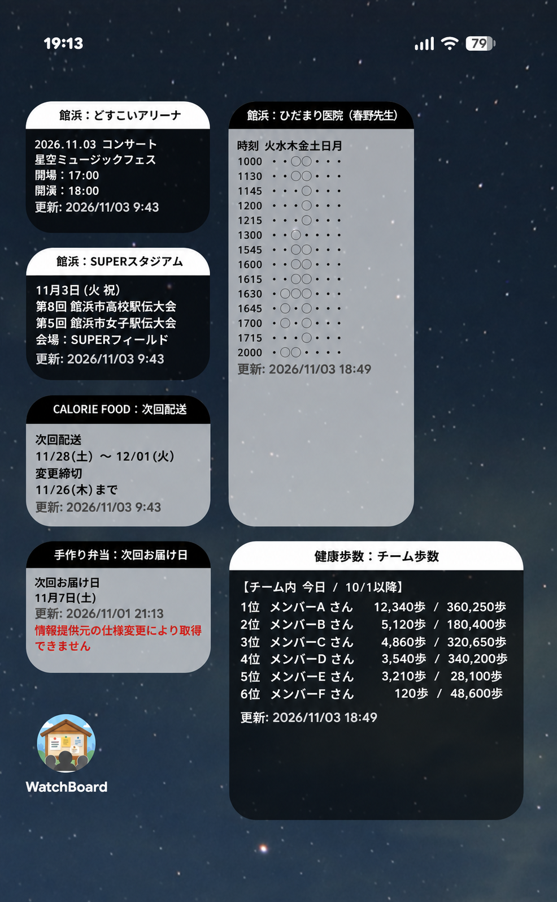

# WatchBoard

WebサイトやAPIの情報を、Androidのホーム画面にウィジェットとして表示するアプリです。

## 表示例 / Example

イベント予定や配送予定など、複数の情報をホーム画面にまとめて表示するイメージです。

画像内の名称・データは説明用の架空例です。利用できる情報ソースはアプリ内でご確認ください。

Illustrative example; names and data are fictional. Available information sources are listed in the app.

## 概要

毎回Webサイトを開かずに、必要な情報をホーム画面から確認できます。
運営サーバーから配信される情報ソースを選び、更新間隔や文字サイズ、背景の表示を設定して利用します。

このリポジトリでは、インストール用APK、使い方、およびアプリ内に同梱している案内文書を公開しています。

## 主な機能

- 情報ソースの検索・選択と取得結果のプレビュー
- 標準・小型の2種類のウィジェット、複数のウィジェットの配置
- 定期更新のON / OFFと、15分・30分・1時間・3時間・6時間・12時間の更新間隔
- 「今すぐ更新」による手動更新
- 文字サイズ、白黒反転、背景の半透過、更新日時の表示設定
- ウィジェットのタイトルから設定画面、本文から情報提供元のWebページを開く
- 通信に失敗した場合、最後に取得できた内容を保持
- 公開情報ソースのログインなしでの利用
- Googleログインと、アカウントの利用権に応じた情報ソースの表示

## 情報ソースの追加

ソースの追加についてはご相談ください（有償の場合あり）。

## ダウンロード・インストール

バージョン：0.3.0

[WatchBoard-v0.3.0.apkをダウンロード](https://github.com/otokame/WatchBoard/releases/download/v0.3.0/WatchBoard-v0.3.0.apk)

1. Android端末へAPKをダウンロードします。
2. ダウンロードしたAPKを開きます。
3. Androidから求められた場合は、使用したブラウザやファイルアプリに「この提供元のアプリを許可」などのインストール許可を設定します。項目名は端末により異なります。
4. インストール後、アプリ一覧から「WatchBoard」を起動します。

インストール許可は、インストール後に元へ戻せます。Google Play経由の配布ではありません。

既存版の更新では、アンインストールせずに上書きしてください。署名の異なるテスト版などには上書きできません。アンインストールやアプリのデータ削除で設定と端末内データが消えるため、先に必要な設定を控えてください。

## 使い方

1. 「情報ソース」欄で取得したい情報を選びます。名前や説明の一部を入力して検索できます。
2. 更新間隔を設定します。初期値は情報ソースの推奨値に合わせて設定されます。
3. 「今すぐ更新」を押し、プレビューを確認します。
4. 「表示設定」またはプレビューをタップし、文字サイズや背景などを調整します。元の設定画面へ戻って「保存」を押すと確定します。
5. 新規作成の場合は、ランチャーの追加画面でウィジェットの配置を完了してください。ホーム画面のウィジェット一覧から「WatchBoard（標準）」または「WatchBoard（小型）」を追加する方法も利用できます。
6. 配置後は、ウィジェットのタイトルをタップすると設定画面、本文をタップすると情報提供元のWebページが開きます。閲覧用ページが設定されていない場合は設定画面が開きます。

サイズ変更や追加画面の操作は、利用しているランチャーにより異なります。

## Googleアカウントと情報ソース

- 公開情報ソースはGoogleログインなしで利用できます。
- ログインが必要な機能は、右上メニューの「Googleアカウント」からログインして利用します。
- 表示される情報ソースは、ログイン状態とアカウントの利用権によって変わります。Googleログインだけですべての情報ソースが利用可能になるわけではありません。
- 情報ソースによっては、取得先サービスのIDやパスワードなどの入力が必要です。正当な利用権のあるアカウントを使用してください。
- ログアウトすると、認証が必要な情報ソースの更新を停止し、端末内の個人用取得データを削除します。

## 利用上の制約

- インターネット接続と運営サーバーが必要です。サーバー停止や情報提供元の変更により、取得できなくなる場合があります。
- 情報ソースは運営側で追加・変更・停止されることがあります。
- 設定した更新間隔は、正確な時刻の実行や、情報提供元からの再取得頻度を保証しません。Androidのバックグラウンド制限や省電力設定、サーバー側の待ち時間の影響を受けます。
- 同じ情報ソースを使う複数のウィジェットでは、更新処理と取得結果を共有します。
- 通信失敗時には古い情報を表示し続ける場合があります。重要な情報は提供元の公式情報で確認してください。
- **この版のアプリ内「リクエスト」送信機能は準備中です。** 同梱ヘルプのリクエストに関する説明には今後の機能案内が含まれます。
- アプリの画面表示と同梱の案内文書は日本語です。
- 端末内データのAndroid自動バックアップは無効です。再インストールや端末変更では、設定やログイン情報の再設定が必要です。

## 通信とデータの取り扱い

- 情報取得のためにWatchBoardサーバーへ通信します。バックグラウンド更新でも通信が発生します。
- Google認証を利用する場合は、利用者識別情報や認証用トークンを扱います。GoogleアカウントのパスワードをWatchBoardへ入力する必要はありません。
- 取得先サービスの認証情報は端末内に暗号化して保存し、必要な情報取得要求の際にHTTPSでWatchBoardサーバーへ送信します。
- 詳細は、既存の[プライバシーポリシー](doc/privacy_policy.md)および[利用規約](doc/terms_of_service.md)をご確認ください。アプリ内の「利用規約・プライバシーポリシー」からも読めます。

## 動作環境

- Android 8.0（API 26）以上
- ホーム画面ウィジェットに対応したランチャー
- インターネット接続
- Googleログインを利用する場合は、それに対応したGoogleアカウント・端末環境

## 案内文書

- [ヘルプ](doc/help.md)
- [利用規約](doc/terms_of_service.md)
- [プライバシーポリシー](doc/privacy_policy.md)
- [WatchBoardについて](doc/about.md)

上記文書はアプリに同梱されている既存の文書です。この版の機能上の制約は本READMEも併せてご確認ください。

## 利用条件

本アプリおよびサービスの利用条件、免責事項、情報の取り扱いは、上記の利用規約とプライバシーポリシーに従います。情報ソースの追加・調整等については、既存の利用規約に有償対応の案内があります。

アプリに含まれる第三者製ライブラリの権利は、それぞれの権利者に帰属します。

---

# WatchBoard — Information Widgets for Android

## Overview

View information from websites and APIs on your Android home screen. Choose a source supplied by the WatchBoard server, adjust the refresh interval and appearance, and add a widget.

This repository distributes an installable APK, usage instructions, and the existing documents bundled with the app. The app interface and bundled documents are in Japanese.

## Main Features

- Search and select information sources; preview retrieved content
- Standard and compact widgets; multiple widget instances
- Automatic refresh intervals of 15 minutes, 30 minutes, 1 hour, 3 hours, 6 hours, or 12 hours, with an OFF option
- Manual refresh with **今すぐ更新** (Update now)
- Adjust text size, color inversion, translucent background, and timestamp display
- Tap the title to open settings or the body to visit the source website
- Retain the last successful content when a request fails
- Use public sources without signing in
- Google sign-in and source availability based on account entitlements

Please contact us to discuss adding information sources (fees may apply).

## Download and Installation

Version: 0.3.0

[Download WatchBoard-v0.3.0.apk](https://github.com/otokame/WatchBoard/releases/download/v0.3.0/WatchBoard-v0.3.0.apk)

Download and open the APK on your Android device. If prompted, allow your browser or file manager to install apps from this source. Install and launch **WatchBoard**. You can turn that permission off afterward. This is a direct distribution outside Google Play.

Install updates over the existing app without uninstalling it. Android cannot install an update over a build signed with a different certificate. Uninstalling or clearing app data removes local settings and data; note any settings you need before doing so.

## How to Use

1. Select a source under **情報ソース** (Information source). Type part of its name or description to filter the list.
2. Choose a refresh interval. The initial setting follows the source’s recommendation.
3. Select **今すぐ更新** (Update now) and check the preview.
4. Open **表示設定** (Appearance) or tap the preview to adjust display options. Return to the main settings screen and select **保存** (Save) to apply them.
5. Complete your launcher’s widget placement flow. You can also add the standard or compact WatchBoard widget from the home screen’s widget picker.
6. Tap the widget title to reopen settings. Tap its body to visit the source website; if no valid website is supplied, settings open instead.

Placement and resizing depend on your launcher.

## Accounts, Limitations, and Data

- Public sources work without Google sign-in. For features that require an account, open **Googleアカウント** (Google account) from the menu.
- Available sources depend on both sign-in state and account entitlements. Signing in does not unlock every source.
- Some sources require credentials for the source service. Use only accounts you are authorized to access.
- Signing out stops authenticated source updates and removes personal cached snapshots from the device.
- Internet access and the WatchBoard server are required. Sources may change, stop working, or be withdrawn.
- Refresh intervals do not guarantee exact timing or a new collection from the original provider. Android background limits, power-saving settings, and server cooldowns can delay updates.
- Widgets using the same source share update work and retrieved content.
- Content may be stale after a failed request. Check the original provider for important information.
- **In-app request submission is not available in this version.** The bundled help includes descriptions of planned request features.
- Android automatic backup is disabled for local app data. Reinstallation or switching devices requires reconfiguration and sign-in again.
- The app communicates with the WatchBoard server, including during background updates. Google sign-in uses identifying information and authentication tokens; WatchBoard does not require your Google password.
- Source-service credentials are encrypted on the device and sent over HTTPS to the WatchBoard server when needed to retrieve information.

## Requirements and Terms

Android 8.0 (API 26) or later, a launcher supporting home screen widgets, and internet access are required. Google sign-in also requires a compatible account and device environment.

See the existing Japanese [Terms of Service](doc/terms_of_service.md), [Privacy Policy](doc/privacy_policy.md), [Help](doc/help.md), and [About](doc/about.md). The Terms cover service availability, disclaimers, and possible paid work for source additions or adjustments. Third-party libraries remain the property of their respective rights holders.

